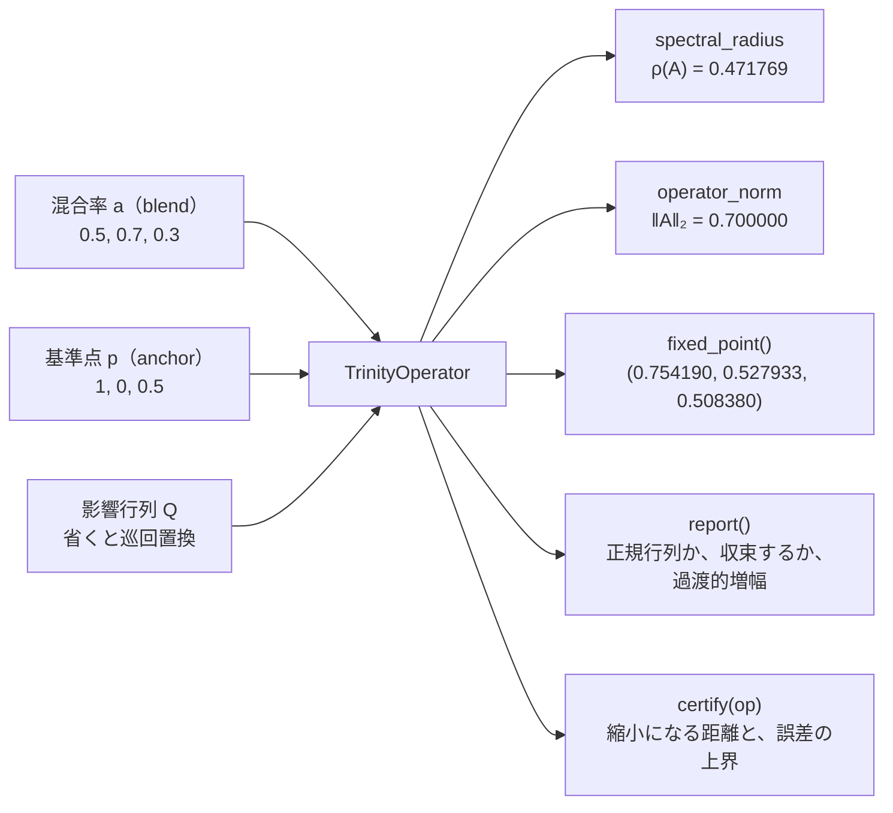

# trinity-operator

種類：ソフトウェア　状態：改訂中

<details>
<summary><b>In English</b> — what this is, and a note on the Japanese comments</summary>

Type: Software · Status: In revision

**What this is.** An implementation of the operator `x ← DQx + (I − D)p` of the three
Trinity-Infinity papers, beyond the assumptions the papers made. The papers' norm condition
`‖DQ‖₂ < 1` is sufficient, not necessary; the spectral radius `ρ(DQ) < 1` decides
convergence. Known tools only; no new mathematics.

**Language of the code.** Identifiers are in English. Code comments, docstrings, the
printed messages of the scripts and this README are in Japanese. The numbers the scripts
print and their pass or fail exit codes do not depend on the language. The repeated-games
note ([`games/README.md`](games/README.md)), its open problem page
([`games/OPEN-PROBLEM.md`](games/OPEN-PROBLEM.md)), the scope of continuing it
([`games/SCOPE.md`](games/SCOPE.md)) and the lessons ([`lessons/`](lessons/)) are written in
English.

**Try it.** `pip install numpy`, then `python3 examples/one_minute.py`. The expected output
is [`examples/one_minute.txt`](examples/one_minute.txt). `python3 verification/run_all.py`
runs every check that CI runs. NumPy is the only dependency outside the standard library.

**Bug reports.** The issue form asks for the steps to reproduce and the environment, in
Japanese or English.

</details>

Trinity-Infinity の三本が扱っている作用素を、論文が置いた仮定の外まで実装したものです。

論文が主張したことを弱めるためではありません。必要以上に強い仮定を外すと、何が本当に効いて
いたのかが見えるからです。

## 論文が言っていること

三本が扱うのは、この反復です。

```
x ← D Q x + (I − D) p        D = diag(a),  Q = 巡回置換行列
```

| | 条件 | 結論 |
| --- | --- | --- |
| [Series I](https://doi.org/10.5281/zenodo.22058624) | Q は巡回置換、a は一様なスカラ α | `‖f(x) − f(y)‖ = α‖x − y‖` なので縮小写像 |
| [Series II](https://doi.org/10.5281/zenodo.22058777) | a を座標ごとに変える | 縮小定数は maxᵢ aᵢ |
| [Series III](https://doi.org/10.5281/zenodo.22058964) | 要素数を n に | 任意の n ≥ 2 で同じ |

三本はいずれも「作用素ノルムが 1 未満」までしか言っていません。

## ここで示すこと

収束を決めているのは作用素ノルムではありません。スペクトル半径です。

```
任意の初期値から一意の不動点へ収束する  ⟺  ρ(DQ) < 1
誤差が初手から単調に減衰する            ⟸  ‖DQ‖₂ < 1
```

`ρ(A) ≤ ‖A‖₂` なので、論文の条件は必要以上に強い。等号は A が正規行列のときであり、
論文の設定（Q が置換 ＝ 直交、a が一様）はちょうどその場合です。だから区別が表に
出てきませんでした。

Series II の例では、すでに両者が離れています。

```
ρ(A) = 0.471769     ‖A‖₂ = 0.700000     ← 論文が縮小定数として挙げている値
```

### 論文の設定なら、どちらも手で書ける

論文は `Q` を置換に限っています。その範囲なら、固有値も特異値も閉じた式になります。

```
‖DQ‖₂ = maxᵢ |aᵢ|                         Q は直交なので、特異値は |aᵢ| そのもの
ρ(DQ) = max_c (∏_{i∈c} |aᵢ|)^(1/|c|)      c は置換の巡回。巡回内の幾何平均
```

`Q` が巡回置換（論文の設定）なら巡回は一つなので、`ρ = (∏ᵢ aᵢ)^(1/n)` ——
**`aᵢ` の幾何平均**です。特性多項式が `λⁿ − ∏aᵢ` になることから出ます。

幾何平均 ≤ 最大値。等号は巡回の中の `aᵢ` がすべて等しいときだけです。

| | Series I `a = 0.6` 一様 | Series II `a = (0.5, 0.7, 0.3)` |
| --- | --- | --- |
| `ρ` ＝ 幾何平均 | 0.600000 | **0.471769** |
| `‖A‖₂` ＝ 最大値 | 0.600000 | **0.700000** |
| 比 | 1.0000 | **1.4838 倍** |

Series I は `aᵢ` を一様なスカラに取っています。そこでは四つの値がすべて一致し、区別
そのものが存在しません。区別の無い設定から始めたので、区別が要ることが見えませんでした。
Series II で `aᵢ` をばらしたとき差は開いたが、そこでも作用素ノルムのまま進んでいます。

この閉じた式は新しい数学ではありません。重み付き巡回シフトの特性多項式であり、論文が
持っていた構造をそのまま使えば出ます。論文はこの構造を使っていません。
`permutation_cycles` と `closed_form_radius` / `closed_form_norm` に実装し、
置換 200 通りで NumPy の固有値と最大差 1.6×10⁻¹⁵ まで一致することを確かめました。

### 区別が効く場面

`ρ < 1 ≤ ‖A‖₂` のとき、収束はします。ただし誤差はいったん増えてから減ります。

```
Q = [[1, 40], [0, 1]],  a = (0.5, 0.5)
  ρ(A) = 0.50        収束する
  ‖A‖₂ = 20.01       論文の条件は満たさない

  誤差  5.000 → 58.019 → 59.005 → … → 4.36e-09
                          ↑ 初期値の 11.8 倍。第 2 段が最大
```

論文の「初手から幾何的に減衰する」という描像は、ここでは成り立ちません。
`‖A‖₂ < 1` を仮定していたので、この場合が視野に入っていませんでした。

この `Q` は置換行列でも、行確率行列でもありません。第 1 行の成分の和が 1 になりません。
だからこの例は、一般のアフィン反復 `x ← Ax + b` の例です。
Friedkin–Johnsen の意見の読み（`W` が行確率で、`Λ` の対角が `[0,1]` にある）は、この例には当たりません。
その範囲では `‖ΛW‖_∞ ≤ 1` なので、誤差の成分の最大値は段ごとに増えません。
上の山は、意見の模型の外で起きています。
この区別は 2026-11-12 に足しました。Academia Co-scientist（言語モデルの研究補助）の出力が指摘し、
Claude が README と照合しました（[self-correction の TI-012](https://github.com/cpsbvbng26-dotcom/self-correction/blob/main/REGISTER.md)）。

### 置換であることも、等長であることも要らない

Series III は「三要素である必要はない」を示しました。等長性まで外せます。

| Q | ρ(A) | ‖A‖₂ | |
| --- | --- | --- | --- |
| 巡回置換（論文） | 0.6000 | 0.6000 | 収束 |
| ランダムな直交行列 | 0.6000 | 0.6000 | 収束 |
| 非正規・非直交 | 0.4211 | 0.7219 | 収束 |
| 特異行列（rank 1） | 0.4089 | 0.5898 | 収束 |

**必要なのは `ρ(DQ) < 1` の一点だけ**です。Q が置換であること、a が (0,1) にあること、
要素が三つであることは、いずれもその十分条件を作るための道具にすぎません。

## 壊れた議論を、そのまま組み直す

ここまでは「論文の条件は必要以上に強い」を**測って**います。`certificate.py` は
その続きで、足りなくなった分を作り直します。

論文の議論はこう進みます。

```
‖A‖₂ < 1  →  f は縮小写像  →  バナッハの不動点定理  →  一意の不動点へ収束
```

`ρ < 1 ≤ ‖A‖₂` の領域では、結論は正しいまま、議論だけが壊れます。
ユークリッド距離で測るかぎり f は縮小写像ではないので、定理を当てられません。

やることは一つです。f が縮小写像になる距離を、その場で作ります。

```
P − BᵀPB = I          B = A/γ,  ρ < γ < 1     ← リアプノフ（Stein）方程式
‖x‖_P = √(xᵀPx)

  ‖Ax‖_P ≤ κ‖x‖_P      κ = γ√(1 − 1/λmax(P)) < γ < 1      全ての x で
```

`‖x‖_P` はユークリッド距離と同値なので `(ℝⁿ, d_P)` は完備で、バナッハの定理が
字義どおり当たります。論文が使いたかった議論が、論文の条件を満たさない例でも通ります。

```
python3 certificate.py
```

先の反例（`ρ = 0.5`、`‖A‖₂ = 20.01`）で実際に作ったもの:

```
γ = 0.750000   κ = 0.749937   増幅 = 69.35
‖xₖ − x*‖ ≤ 69.35 × 0.749937^k × ‖x₀ − x*‖      ← 全 61 段で内側
```

右辺の係数 69.35 が、`trinity.py` で測っていた過渡的増幅にあたります。誤差は
いったん増えてよい。増えたうえで κ のレートに乗る、という形になります。

`κ` はこのノルムでの `‖A‖_P` の上界ではなく、**達成される値そのもの**です
（コレスキー分解から計算し直して一致することを検査している）。

### γ は目盛りであって、無料ではない

| γ | κ | 増幅 |
| --- | --- | --- |
| 0.5500 | 0.549999 | 382.7 |
| 0.6000 | 0.599995 | 184.9 |
| 0.7500 | 0.749937 | 69.35 |
| 0.9000 | 0.899770 | 42.08 |
| 0.9900 | 0.989601 | 34.06 |

γ を ρ に近づけるほど κ は小さくなるが、係数は大きくなります。「どんな
ρ < 1 でも κ < 1 の距離が取れる」が内容であって、「良い定数が取れる」ではありません。

論文の設定（`‖A‖₂ < 1`）では、この構成は何もしません。Series II では
`κ = 0.544364`、増幅 `1.2859`。作り直す必要が無いからです。

### これも新しい数学ではない

「任意の ε > 0 に対して `‖A‖ ≤ ρ(A) + ε` となるノルムが存在する」は
**Ostrowski / Householder の古典的な結果**で、教科書に載っています。
リアプノフ方程式を解いてそのノルムを構成するのも標準的な手順です。

ここでやったのは、**存在証明で終わっている構成を実際に走らせ、出したものが本当に
主張どおりかを検査したこと**だけです。意味があるのは文脈のほうで、
論文の議論は `ρ < 1 ≤ ‖A‖₂` で壊れるが、**壊れたままにしておく必要はない**、
という一点です。

## 展望 —— ここから先、コードだけでどこまで言い切れるか

仮定を一つずつ外すと、三篇の結論のどれが残り、どれが落ちるかを、段ごとに実行できる
形で並べてあります（[`roadmap/`](roadmap/)）。肩書きの段階ではなく、「コードで
言い切れる／推定までしか言えない／原理的に言えない」の三つで区切っています。

| 段 | 外す仮定 | 何が起きるか | コードで言い切れるか |
| --- | --- | --- | --- |
| 1 | 右辺 `W = I` の決め打ち | 縮小定数は変わらず、係数だけ最大 1.83 倍縮む | **言い切れる**（閉形式と一致） |
| 2 | 毎段が同じ作用素 | 各段が縮小でも、切り替えると発散しうる | 場合による（決定不能な場合がある） |
| 3 | 切り替えが決定的 | 「収束」が二つに割れ、一致しない窓がある | 半分（二乗平均は厳密、指数は推定） |
| 4 | 統合が線形 | 唯一性が落ちる。不動点が複数になる | **言い切れない**（標本評価） |
| 5 | 要素が有限個 | `ρ` が極限へ渡らない。`‖A‖` は渡る | 片側だけ |
| 6 | 影響行列が巡回置換 | 一点の均衡では区別がつかない。作用素として見ると、像の次元が一般の `n(n−1)` から `n` に落ちる | 像の次元は**言い切れる**（ヤコビ行列の階数）。一点の必要条件は推定まで |

段 5 はこの実装自身の主張を弱めます。有限次元では「効いているのは `ρ` のほうだ」
と言えるが、無限次元では鋭さと計算しやすさが逆転し、論文が使っていた `‖A‖` の
ほうが安全になります。

```
python3 roadmap/stage1_optimal_norm.py    # 最善の重み付きノルム
python3 roadmap/stage2_switching.py       # 切り替え系と同時スペクトル半径
python3 roadmap/stage3_stochastic.py      # 確率的な切り替え。二つの「収束」
python3 roadmap/stage4_nonlinear.py       # 非線形な統合。唯一性が落ちる
python3 roadmap/stage5_infinite.py        # 無限次元。ρ が極限へ渡らない
python3 roadmap/stage6_general_influence.py  # 一般の影響行列。落ちるのは次元
```

独自性はどの段も低い。どれも既存の分野の標準的な道具で、教科書に載っています。
この作業で新しいのは、三篇の作用素という一つの対象についてそれらを実際に走らせ、
どこで何が落ちるかを数値で並べたことだけです。詳しい評価と、NumPy では届かない
場所の一覧は [`roadmap/README.md`](roadmap/README.md) にあります。

## 使い方

[`examples/`](examples/) に、一分で試せる例を置いています。

```
pip install numpy
python3 examples/one_minute.py   # 出力は examples/one_minute.txt と同じになる
python3 verification/run_all.py  # CI が回す検査を、一度に全部
```

依存は NumPy の一つだけで、ほかは Python の標準ライブラリで動きます。
`verification/check_text.py` と `verification/check_site.py` は、NumPy も使いません。
`verification/check_docs.py` が、全部の台本の `import` を見ています。
標準ライブラリと NumPy と、このリポジトリの中の台本のほかを読み込めば落ちます。

### 何を渡すと何が返るか



図の数値は、[`examples/one_minute.py`](examples/one_minute.py) の一つめの例が出したものです。
`verification/check_docs.py` が、図の数値が例の出力にあるかを見ています。

以下は、検査と台本を一本ずつ回すときの並びです。

```
python3 demo.py         # 論文の再現と、仮定を外したときの挙動
python3 certificate.py  # 縮小になる距離を作って、上界が実際を覆うか見る
python3 check.py        # 29 項目の検査
python3 verification/check_certificate.py   # 証書の 51 項目
python3 verification/check_roadmap.py       # 展望の 81 項目
python3 verification/check_citation.py      # CITATION.cff が名乗る数値
python3 verification/check_lessons.py       # 教材の頁が書く数値
python3 verification/check_games.py         # 繰り返しゲームのノートの数値と命題
python3 verification/check_site.py          # 予想の英語サイト（site/）
python3 standard.py                          # DeGroot と Friedkin–Johnsen を文献の記号で
python3 verification/check_standard.py       # その古典的な事実を乱数の模型で当てる
python3 verification/check_secrets.py        # 秘密情報と個人の連絡先
python3 verification/check_docs.py           # 札・図・例・開いている問題・版と DOI・依存・様式・件数（要: 隣の trinity-infinity）
python3 verification/check_guards.py         # 検査を壊して、落ちることを確かめる
```

```python
from trinity import TrinityOperator
from certificate import certify

op = TrinityOperator(blend=[0.5, 0.7, 0.3], anchor=[1, 0, 0.5])
print(op.report())
print(op.fixed_point())        # [0.754190 0.527933 0.508380]
```

`Q=` に任意の行列を渡せます。`report()` が ρ と ‖A‖₂ の両方、正規行列かどうか、
過渡的増幅 `maxₖ ‖Aᵏ‖₂` を出します。

```python
cert = certify(op)             # f が縮小写像になる距離を構成する
print(cert.kappa)              # そのノルムでの縮小定数
print(cert.bound(20, e0))      # 第 20 段の誤差の上界
print(cert.audit())            # 証書そのものを乱数で当たり直す
```

## これは新しい数学ではない

非正規行列の過渡的増幅は、数値線形代数の標準的な事実です。
`x ← Ax + b` の収束条件が `ρ(A) < 1` であることも、教科書に載っています。

このリポジトリが主張するのは一点だけです —— 三本が置いた仮定は、必要以上に強い。
新しい定理を出したのではなく、既にある道具で既存の主張の輪郭を測り直しています。

Trinity-Infinity の系列は「野心的な枠組みを証明とコードに通したとき何が残るか」を
記録したものです。これはその続きで、**残ったものが本当はどこまで成り立つのか**を
測っています。

## 文献の記号で計算し直す

`standard.py` は、意見動学の二つの標準模型を文献の側の記号で書き、手で証明できる
古典的な事実を計算します。DeGroot（1974）の `x(k+1) = Wx(k)` と、Friedkin–Johnsen（1990）の
`x(k+1) = ΛWx(k) + (I−Λ)u` です。

三篇は自分の記号（D、Q、p）で考えていました。だから、既知の模型だと気づきませんでした。
記号を文献に寄せると、三篇の作用素は W を巡回置換に限った Friedkin–Johnsen で、
Λ = D、W = Q、u = p と読めます。

確かめているのは三つです。DeGroot では、原始的な W のもとで意見が左ペロン・ベクトルで
重み付けた平均に揃うこと。Friedkin–Johnsen では、均衡が `V u` で、
`V = (I−ΛW)⁻¹(I−Λ)` が行確率行列になること。そして三篇の不動点が、
W を巡回置換にした Friedkin–Johnsen の均衡と一致することです。

`verification/check_standard.py` は、これらを乱数で作った模型に当てます。W の行和を崩すと
V の行和も 1 でなくなることを、否定の対照として確かめています。新しい結果はありません。

W が巡回置換のときは、V を逆行列なしで書けます。三篇の σ（主体 i が i − 1 を聞く）では、
`V[i, i−k] = λᵢ λᵢ₋₁ ⋯ λᵢ₋ₖ₊₁ (1 − λᵢ₋ₖ) / (1 − λ₁ ⋯ λₙ)` です。主体 j の初期意見が
主体 i に残る重みは、j から i までの道の感受性の積で決まります。
`fj_cyclic_closed_form` がこれを組み、逆行列で求めた V と 200 件で突き合わせています。

この式は三篇にはありません。検索した範囲では、有向の巡回に限ってこの形を明示した文献を
見つけていません。見つけていないことは、無いことの証明ではありません。等比級数を一度足せば
出る式であり、新しい結果とは言いません。先行する文献が見つかれば、そちらを引いてここを直します。

## 教材

[`lessons/`](lessons/) に、この作用素を題材にした自習用の教材を置いています。
題は *The Friedkin–Johnsen model with a cyclic influence matrix* です。
この作用素が、影響行列を巡回置換に限った Friedkin–Johnsen モデルであることを、
教材の入口に置きました。三篇が十分条件を必要条件のように扱った箇所を、
一回ずつ直していく順路になっています。取り違えた本人が書いているので、各回の終わりに
「どこを取り違えたか」を置きます。

新しい数学ではありません。教科書にある事実を、一つの作用素で走らせて確かめる材料です。
頁が書く数値は、各回の台本が出すものと一字一句で突き合わせています。

教材の文章は CC BY 4.0、台本は MIT です。五回とも下書きがそろいましたが、
著者の確認はまだ済んでいません。

## 繰り返しゲーム

[`games/`](games/README.md) に、この作用素と三篇の繰り返しゲームをつなぐノートを置いています。
英語で書いています。
命題 1〜7 と予想の英語の論文版を、Figshare に置いています（[`10.6084/m9.figshare.34419198`](https://doi.org/10.6084/m9.figshare.34419198)、2026-10-13）。
その版は凍結しています。保守しているのは、ノートの頁と台本のほうです。
凍結した版は、予想の (a) と (b) を予想として載せたままです。その版は直しません。(a) と (b) を証明した命題 8 と命題 9 は、ノートと、解決の稿にあります。
解決の稿は、別の項目として Figshare にあります（[`10.6084/m9.figshare.35050300`](https://doi.org/10.6084/m9.figshare.35050300)）。
DOI は 2026-11-18 に利用者から受け取りました。
凍結した版の新しい版ではありません。
原稿・PDF・台本は [golden-window-resolution](https://github.com/cpsbvbng26-dotcom/golden-window-resolution) にあります。
プレプリントであり、査読は受けていません。

巡回する均衡の道での継続価値は、`D = δI` とした作用素の不動点になります。
均衡かどうかは、その不動点の成分ごとの不等式で決まります。
式そのものは、割引価値の教科書の公式です。

三人で D の役を巡回させる道は、`δ ≥ 1/φ` のときに限って均衡になります。
Series II 第4節の例 `(2,4,2)` は、どの δ でも持続しません。
`(2,4,2)` と `(3,3,3)` を結ぶ線分の上では、持続に要る δ の閾値を証明しています。

ノートには予想も置いています。
名前は黄金比の窓の予想（Golden-window conjecture）です。窓は `1/φ` から `2/3` までの区間を指します。
予想は二つの部分からなります。
(a) は、公開の乱数を使わないとき、この窓の中で持続できる利得の集合は長さが 0 になる、というものです。
(b) は、その次元が 1 未満で、δ とともに切れ目なく 0 から 1 へ上がる、というものです。
(a) と (b) は、2026-11-18 に証明しました。(a) が命題 8、(b) が命題 9 です。
2026-11-18 に利用者が求め、Claude が (a) と (b) の証明を書きました。
責任は著者にあります。
同じ日に、文献と照合しました。読んだところは、ノートの「The literature check of 2026-11-18」の節に分けて書いています。
命題 8 は既知です。Lu・Steiner・Zou（2026）の Proposition 2.5 の、すぐ出る特別な場合です。
この記録の数え方では、命題 8 はゼロに移ります。
命題 9 の式は、Lu・Steiner・Zou（2026）の Theorem 1.2 と Lemma 2.7 の特別な場合です。この部分もゼロです。
β と穴が一緒に動くこの曲線に沿った連続・δ についての狭義の増加・両端の極限は、読んだ文献には見つかりませんでした。
この部分は、まだ数えていません。
長さが 0 であることから、(b) は決まりません。(b) は命題 9 で別に証明しました。
命題 9 は、次元を `Σ_{n ∈ A_δ} δ^(ns) = 1` の根 `s` として与えます。
次元は δ について狭義に増えます。予想の「減らない」より強い結果です。
二つの部分がそろったので、予想は解決済みです。
名前の「黄金比の窓の予想」は、問題の名として残します。名前はすでに公開した DOI とラベルに入っているからです。状態は「解決済み（(a) と (b) の式は既知の定理の特別な場合。δ についての連続・狭義の増加・両端の極限は、読んだ文献には見つからない）」です。
次元が正であることは命題 6 で証明しました。窓の中で、自己相似な部分集合を作って下界を出しています。
`δ = 1/φ` ちょうどでは、集合が可算無限個の点になることも証明しました（命題 5）。
利得を一般の便益 b と費用 c に広げると、交代で協力する道は、全員で協力する道より常に大きな辛抱を要します（命題 7）。この線形のゲームでは、交代の協力は説明できません。
名前は中身を表すもので、人名ではありません。

2026-11-12 に、予想の数値の確かめを広げました。
窓の中の δ を 0.619 から 0.666 まで 0.001 刻みの 48 通りに増やし、細分の深さを 30 段にしました（`games/scan.py`、出力は `games/scan.txt`）。
区間の数は整数で数えており、丸めの誤差が入りません。
どの δ でも総長は縮み、次元の推定は δ とともに減りませんでした。
これは根拠であって、証明ではありません。この走査の時点では、(a) も (b) も予想でした。
次に回す格子と、何が出たら予想に反するとみなすかは、OSF の事前登録（[`games/PREREGISTRATION.md`](games/PREREGISTRATION.md)、英語）に先に書きました。
OSF への登録は、2026-11-12 に著者がいったん止めました。2026-11-16 に著者が出し、2026-11-17 に承認しました。
登録の DOI は [10.17605/OSF.IO/6EW38](https://doi.org/10.17605/OSF.IO/6EW38) です。OSF にある文が優先します。
この記録は、2026-11-17 に利用者が登録し、DOI を受け取って Claude が書きました。
登録のあとで、確かめの格子（54 通り、深さ 32 段）を回しました（出力は `games/scan-confirmatory.txt`）。
54 通りのどれでも総長は縮み、次元の推定は 1 未満で、δ とともに減りませんでした。
2/3 の近くでは 1 との差が小さく、これも根拠であって証明ではありません。

命題 1〜7 は文献と照合していません。既知の演習である可能性があります。

三篇の数学への寄与はゼロです。ノートの命題 1〜7 と、命題 9 の連続・狭義の増加・極限は、ゼロではなく、まだ数えていません。命題 8 と命題 9 の式は、照合でゼロに移りました。
「ゼロ」は、照合した結果、新しいものが無かった状態です。「数えていない」は、照合がまだの状態です。
照合して先行が無ければ、小さいが新しい結果になります。先行が見つかればゼロに移し、
その文献をノートに引きます。命題 1〜7 の照合はまだしていません。
`verification/check_games.py` が、頁の数値を台本と突き合わせ、各命題を別の計算で確かめます。

証明済みの範囲と開いている範囲を、[`games/OPEN-PROBLEM.md`](games/OPEN-PROBLEM.md) の一枚にまとめました。
英語で書いています。数値で調べた範囲と、反例の探索が記録に無いことも、そこに書きました。
開いた部分には、issue のラベルを一つずつ割り当てています。
(a) と (b) のラベルは、解けたあとも、証明の誤りの知らせのために残しています。表には解決済みと書きました。

この予想をどこまで続けてよいかは、[`games/SCOPE.ja.md`](games/SCOPE.ja.md) に書きました（英語の版は [`games/SCOPE.md`](games/SCOPE.md)）。
決めごと 15 は、学部二年次以降の仕事を、学部一年次の成果の続きか修正に限っています。
その頁は、何が続きに入り、何が新しい主題になるかを分けています。

予想だけを英語で載せたサイトを、[golden-window-conjecture.vercel.app](https://golden-window-conjecture.vercel.app/) に置いています。
中身は [`site/`](site/) で、Vercel がこのディレクトリをそのまま配ります。
`site/index.html` は生成物です。researcher-profile の英語の頁と同じ設定から作っており、本文はそちらと同じです。
ロゴ（`site/favicon.svg`）は、窓の枠の中に、穴を挟んで二つに分かれる帯を三段重ねた図です。
共有したときのカードには、同じ図を正方形の画像（`site/og.png`）にして出します。
帯の比は図のためのもので、実際の写像の縮尺ではありません。

2026-11-23 から、サイトには予想のサイトだけの意匠を当てています。
頁の上端の墨の帯、最初の画面の右肩の渦、見出しの下の飾り、状態の段と δ の範囲ごとの行の札です。
帯と飾りは、ロゴと同じ作り方で、区間の両端の二つを長さの 1/φ² ずつ残す操作を繰り返したものです。ロゴはこの比を 0.38 に丸めています。
渦は、黄金比の長方形を正方形で切り分けて描きます。
どれも飾りで、予想の集合 T_δ の図ではありません。
数と CSS は researcher-profile の `golden-window-design.js` にあり、`site/index.html` を作り直すと入ります。
`verification/check_site.py` が、形を φ の式から数え直し、色をロゴの塗りと突き合わせます。

サイトの見た目の部品について、作り手と出所、権利と許諾、関わる法令の条を書いた頁を、英語（[`site/design-legal.html`](site/design-legal.html)）と日本語（[`site/design-legal.ja.html`](site/design-legal.ja.html)）で置いています。
二つとも手で置いた頁で、生成物ではありません。2026-11-22 に Claude Code（Anthropic）が書きました。
頁が引く条の文は、e-Gov 法令 API から 2026-11-22 に取り寄せた写しで、[`verification/design-statutes.json`](verification/design-statutes.json) にあります。
`verification/check_site.py` が、条の文と SHA-256、部品の表と `site/` のファイル、頁が名乗る数を突き合わせます。
トップの頁からこの二つの頁へのつなぎはありません。トップの頁の下の欄は researcher-profile の生成もとが持つためです。

2026-11-24 から、sitemap に入った頁と消えた頁を IndexNow に知らせています。
鍵は [`site/16529c1323fad834c26ee0393e5f50b8.txt`](site/16529c1323fad834c26ee0393e5f50b8.txt) で、Vercel がサイトの根で配ります。
中身は鍵そのもので、秘密ではありません。
知らせるのは `tools/indexnow.js` です。`site/sitemap.xml` が変わった main への push のあとに、`.github/workflows/indexnow.yml` が回します。
sitemap は `<lastmod>` を持ちません。そのため push で知らせるのは、入った頁と消えた頁だけです。
本文が変わった頁は、ワークフローを手で起こし、all を yes にして送ります。
Google は IndexNow を読まず、sitemap を読みます。sitemap は `site/robots.txt` が名指しています。
`verification/check_site.py` が、鍵のファイルの名と中身と置き場所、ワークフローが見る sitemap、知らせる先のホストを突き合わせます。

2026-11-24 から、サイトの頁の写しを Wayback Machine に頼めます。
頼むのは `.github/workflows/wayback.yml` で、手で起こすときだけ動きます。権限は読むだけです。
`site/sitemap.xml` の頁を一つずつ Save Page Now に頼みます。429 の答えには、1 分と 3 分を空けて頼み直します。
頼んだあと、その日の写しがあるかを `archive.org/wayback/available` で確かめます。
要約に「残った」と出すのは、確かめられた頁だけです。確かめられない頁が一つでもあれば、実行は落ちます。
Wayback Machine の写しは、こちらからは消せません。
そのため、頼む頁はワークフローの `READ` に挙げた頁だけにしています。
`READ` の 3 頁（トップの頁と、デザインに関する法的な扱いの頁の英日）は、2026-11-24 に全文を読みました。
運営者のほかの人の個人の情報は、どの頁にもありませんでした。
人の名は、運営者の名と、トップの頁が引く文献の著者の姓だけです。
文献の著者の姓は、公刊された論文の引用です。同じ引用は、DOI の付いた Figshare の二篇にもあります。
そのため、外した頁はありません。
サイトの頁は PDF を張っていないので、PDF は頼みません。
sitemap に `READ` に無い頁が入れば、その頁は頼まずに実行を落とします。
`verification/check_site.py` が、手で起こすときだけ動くこと、権限、読む sitemap、写しの確かめ、`READ` と sitemap の一致、PDF を張っていないことを見ます。

## 検証

```
python3 check.py
python3 verification/check_certificate.py
python3 verification/check_roadmap.py
```

作用素の主張 29 項目。論文の数値の再現、閉形式と反復の一致、`ρ ≤ ‖A‖₂` が
常に成り立つこと、論文の条件を満たさないのに収束する例、その場合に誤差が増える
こと、`ρ = 1` をまたぐと挙動が切り替わること、置換でも等長でもない Q で収束すること。
そして**置換の場合の閉じた式** —— `ρ` が巡回内の幾何平均に、`‖A‖₂` が `maxᵢ aᵢ` に
一致すること、Series II では幾何平均が最大値より真に小さいこと、Series I では
一致すること、置換でない `Q` には閉じた式を返さないこと。

証書 51 項目。P がリアプノフ方程式の解であること、`‖·‖_P` が本当にノルムで
あること（正値性・斉次性・三角不等式）、f が本当にその距離で縮小写像であること
（二点間の距離で乱数を当てる）、κ が上界ではなく達成値であること、保証した上界が
実際の反復を覆うこと、`ρ ≥ 1` のときに作れたと言わないこと。

上界は `κᵏ` で落ちるので、段を伸ばせば倍精度で表せる下限を割ります。そこから先で
不等式が見かけ上破れるのは反復に溜まった丸め誤差で、検査はその分
（`16ε(1+‖x*‖)(k+1)`）だけを明示して許し、その項を使わずに済んだ段数も一緒に
出します。反例では最後まで不要、正規行列では第 37 段から必要になります。

展望 81 項目。各段が名乗っている性質を計算し直します。厳密に決まること
（スペクトル半径、`E[A⊗A]`、冪零性、閉形式との一致）と、推定でしかないこと
（リアプノフ指数、標本による `‖Df‖` の最大）と、決まらないこと（JSR がちょうど 1）を
分けて扱い、三つ目を「通った」と数えません。

乱数種は固定してあるので、何度実行しても同じ数値が出ます。

検査が空振りしていないことは、`verification/check_guards.py` が確かめます。
通る状態の写しを 130 通りに壊し、130 通りとも落ちることを見ます。
壊すのは、台本の式、頁の数値、使わないと決めた語、札、関連識別子、図の語、ワークフローの固定と権限、様式、要旨、サイトの拡大と配色（面の下の色と地に重ねる光を含む）、予想のサイトの意匠（帯・渦・ロゴの二色・紙）、予想の広げた走査と事前登録と確かめの走査の結果、命題 8 と 9 とその表と状態、デザインに関する法的な扱いの頁と引いた条の写し、IndexNow の鍵とワークフローと知らせる先、Wayback Machine に頼むワークフローなどです。
この数は `check_guards.py` が自分の壊し方を数えて、ここと突き合わせています。

## 関係

| | |
| --- | --- |
| 論文と検証の保管庫 | [trinity-infinity](https://github.com/cpsbvbng26-dotcom/trinity-infinity) |
| 論文本体 | 上の表の DOI |
| このコードの保存版（Zenodo） | 版 1.0.0 は [10.5281/zenodo.24033459](https://doi.org/10.5281/zenodo.24033459)、すべての版は [10.5281/zenodo.24033458](https://doi.org/10.5281/zenodo.24033458) |

このコードを挙げるときは、使った版の DOI を引きます。すべての版に共通する DOI は、いちばん新しい版を指します。

### 版と DOI

| 版 | 日付 | DOI | 変わったこと |
| --- | --- | --- | --- |
| すべての版 | | [10.5281/zenodo.24033458](https://doi.org/10.5281/zenodo.24033458) | いちばん新しい版を指す |
| 1.0.0 | 2026-11-07 | [10.5281/zenodo.24033459](https://doi.org/10.5281/zenodo.24033459) | 記録にある版はこれだけです。版の前後の変更は [CHANGELOG.md](CHANGELOG.md) にあります |

版を出すのも DOI を受け取るのも、著者が Zenodo で行います。
新しい版が出たら、この表に一行足し、`CITATION.cff` の版と日付も直します。
`verification/check_docs.py` が、表と `CITATION.cff` を突き合わせています。

PDF には手を入れていません。ここにあるのは論文の外側の話です。

## ライセンス

© 2026 根本卓哉（Takuya Nemoto）

ライセンスは、置き場所ごとに次のとおりです。

| 対象 | ライセンス | 書いてある場所 |
| --- | --- | --- |
| 全体（次の行以降を除く） | MIT | ルートの [LICENSE](LICENSE) |
| [`lessons/`](lessons/) の文章 | CC BY 4.0 | [`lessons/LICENSE`](lessons/LICENSE)。台本は MIT と [`lessons/README.md`](lessons/README.md) が書いている |
| [`games/`](games/) の文章 | CC BY 4.0 | [`games/LICENSE`](games/LICENSE)。台本の `games.py` は MIT |
| [`site/`](site/) の頁 | CC BY 4.0 | 頁の末尾の表示。`site/` に LICENSE ファイルは無い |

このリポジトリが引き、または引用を確かめるために置いている他人の文は、CC BY 4.0 でも MIT でも許諾しておらず、それぞれの権利者のものです。

## 言語モデルの利用

このリポジトリの実装・検査・README は Claude Code（Anthropic）を用いて作成し、
実行しました。数値はすべて実行して得たものです。主張の責任は著者にあります。
言語モデルは著作者ではありません。

使った道具と、確かめた人を表にします。

| 道具 | 使ったところ | 確かめた人 |
| --- | --- | --- |
| Claude Code（Anthropic） | 実装・検査・README | 機械の検査（CI）。主張の責任は著者が負う |
| Claude Code（Anthropic） | 教材（[`lessons/`](lessons/)）の下書き | 機械の検査（CI）。著者の確認はまだ済んでいない |
| Claude Code（Anthropic） | 繰り返しゲームのノート（[`games/`](games/)）の命題・証明・予想の下書き | 機械の検査（CI）。著者の確認は記録に無い |

## 著者

根本卓哉（Takuya Nemoto）
[プロフィール](https://cpsbvbng26-dotcom.vercel.app/) ｜
[ORCID](https://orcid.org/0009-0000-1406-0547)

## 運営理念・声明

<!-- 声明:ここから -->
このリポジトリには、根本卓哉の[運営理念・声明](https://cpsbvbng26-dotcom.vercel.app/notes/mission.html)が掛かります。
声明は、運営の考え方を述べたものです。それ自体で、運営者にも、読む人その他の誰にも、権利や義務を生じさせません。
適用されるのは、このリポジトリのライセンスと、[免責事項](https://github.com/cpsbvbng26-dotcom/cpsbvbng26-dotcom/blob/main/DISCLAIMER.md)が挙げるリポジトリではその免責事項です。声明とそれらが食い違うときは、それらが優先します。
この節で「現在」と書いたことは、声明の頁の最終更新の日の時点のことです。
運営者は、現在、弁護士その他の専門家に依頼していません。声明と免責事項は、現在、弁護士の確認を受けていません。
紛争が生じたときは、運営者は、必要に応じて弁護士その他の専門家に相談したうえで、日本の法令（国際的な事件の裁判管轄と準拠法についての定めを含む）に沿って対応します。これは、誰かに対する警告ではありません。
全文は、[サイトの頁](https://cpsbvbng26-dotcom.vercel.app/notes/mission.html)と、cpsbvbng26-dotcom の [docs/mission.md](https://github.com/cpsbvbng26-dotcom/cpsbvbng26-dotcom/blob/main/docs/mission.md) にあります。
<!-- 声明:ここまで -->

責任は、法令の定めるとおりです。説明は[免責事項](https://github.com/cpsbvbng26-dotcom/cpsbvbng26-dotcom/blob/main/DISCLAIMER.md)にあります。
